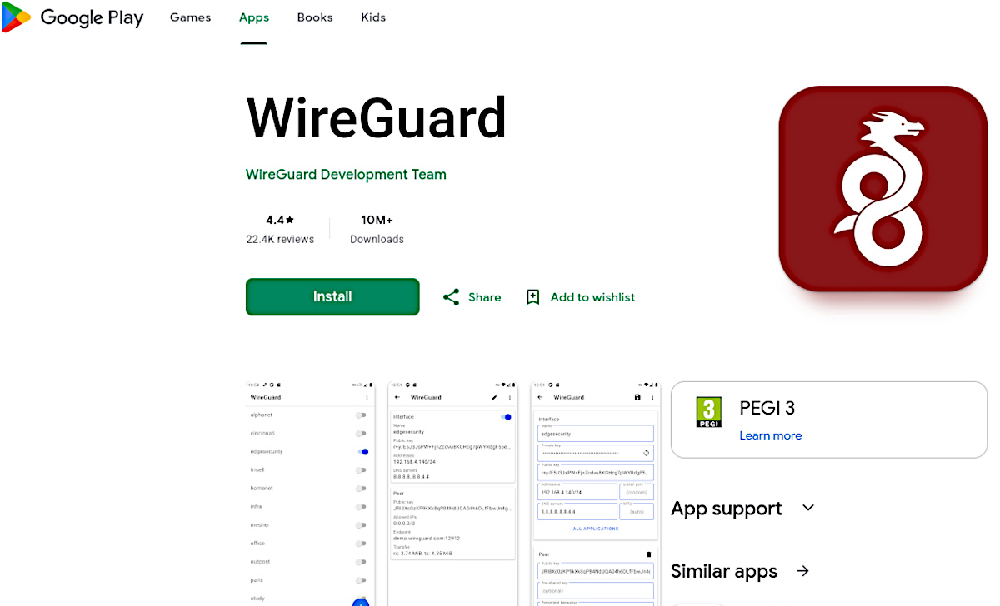
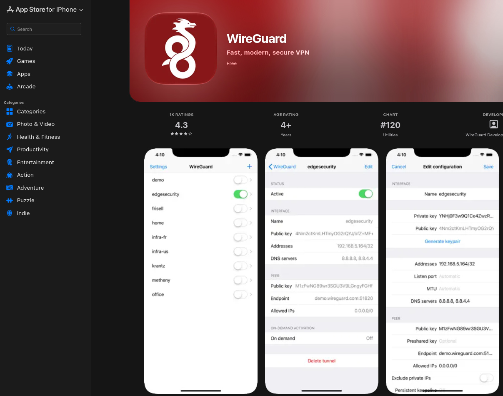

# monVPNperso
all steps from 0 knowledge to 100% installed wireguard vpn, running, affordable, ...


#
<table>
  <tr>
    <td></td>
    <td></td>
  </tr>
</table>

## REQUIREMENTS: 
1 PC or 1 laptop, running either 
* Linux, or 
* Windows, or 
* MacOS (or derivative) ...
1 VPS (eg. flokinet.is or 1984.is or netcup.de, 's most basic and affordable VPS offer)

optional : your 100 most impatient friends with their mobile phones devices, in suspense watching you.
#


### Windows users

Open PowerShell or Windows Terminal and install with WinGet:
```
winget install --id FiloSottile.age
```
Close and reopen the terminal, then check that it runs:
```
age --versionage-keygen --help
```

download and save in "$HOME\Desktop" the files from the urls :
```
https://github.com/CULTofBEETROOT/monVPNperso/local4windows_inst_age.ps1
https://github.com/CULTofBEETROOT/monVPNperso/local4ssh_windows.ps1
https://github.com/CULTofBEETROOT/monVPNperso/install_vpn_ON_vps.sh
```
try to run this file :
```
cd "$HOME\Desktop"
.\local4windows_inst_age.ps1
.\local4ssh_windows.ps1
Get-Content "$HOME\.ssh\vps4wireguard*.pub"
```
IF!!! Windows blocks running scripts, allow it for this PowerShell window only, then run the script:
```
cd "$HOME\Desktop"
Set-ExecutionPolicy -Scope Process -ExecutionPolicy Bypass
.\local4windows_inst_age.ps1
.\local4ssh_windows.ps1
Get-Content "$HOME\.ssh\vps4wireguard*.pub"
```
#

### macOS users

Open Terminal and install with Homebrew:
```
brew install age
```
Check the installation:
```
age --versionage-keygen --help
```
Download the script from this url and save the file in "$HOME/Desktop":

```
https://github.com/CULTofBEETROOT/monVPNperso/local4macOs_inst_age.sh
https://github.com/CULTofBEETROOT/monVPNperso/local4ssh_macOs.sh
https://github.com/CULTofBEETROOT/monVPNperso/install_vpn_ON_vps.sh
```
then run the script:
```
cd ~/Desktop
chmod +x local4macOs_inst_age.sh
./local4macOs_inst_age.sh
chmod -x local4ssh_macOs.sh
./local4ssh_macOs.sh
cat "$HOME"/.ssh/vps4wireguard*.pub
```
#

### Linux users (here Debian-based)
Open Terminal and download from root or sudoer with :
```
sudo mkdir -p /root/scripts/
sudo wget -P /root/scripts/ "https://github.com/CULTofBEETROOT/monVPNperso/install_vpn_ON_vps.sh"
sudo wget -P /root/scripts/ "https://github.com/CULTofBEETROOT/monVPNperso/local4linux_inst_age.sh"
sudo wget -P /root/scripts/ "https://github.com/CULTofBEETROOT/monVPNperso/local4linux_age-decyptWGclients.sh"
chmod -x /root/scripts/local4linux_age-decyptWGclients.sh
chmod -x /root/scripts/local4linux_inst_age.sh
sudo bash  /root/scripts/local4linux_inst_age.sh
sudo wget -P /root/scripts/ "https://github.com/CULTofBEETROOT/monVPNperso/local4ssh_linux.sh"
chmod -x /root/scripts/local4ssh_linux.sh
sudo bash /root/scripts/local4ssh_linux.sh
cat /root/.ssh/vps4wireguard*.pub
```
#


BE AWARE: this entire page is being edited and the last bit still missing is :
+ add your VPS public IP in the script where there is a place holder awaiting (the ssh connection code for instance)
+ add your SSh .pub key (above) to the ssh placeholder on the head of install_vpn_ON_vps.sh
+ add your age .pub key (above) to the age public key place holder of install_vpn_ON_vps.sh
+ plan any passphase, soon will they be prompted.


## NOW for EveryOne : INSTALL Debian TRIXIE ON YOUR VPS 
+ from the VPS controle pannel,

  and when allowed, pre-install your SSH public key -the last line in your terminal- via the (Web) Controle Pannel.

  (if you don't find where to install Debian Trixie read your email from the provider and/or login to your online account)


## Once your vps is running, let us copy in the script that will install wireguard server: 

### Windows users, copy-paste into your Powershell terminal: 
```
$key = Get-ChildItem "$HOME\.ssh\vps4wireguard-*" -File |
    Where-Object { $_.Name -notlike "*.pub" } |
    Sort-Object LastWriteTime -Descending |
    Select-Object -First 1 -ExpandProperty FullName

scp -i $key -P 22 "$HOME\scripts\install_vpn_ON_vps.sh" "root@vpsIP:/root/"

```

### macOs users, copy-paste into your terminal:
```
scp -i "$HOME"/.ssh/vps4wireguard-*[!.pub] \
  -P 22 "$HOME/scripts/install_vpn_ON_vps.sh" \
  root@vpsIP:/root/
```

### Linux users, copy paste into your terminal:
```
scp -i /root/.ssh/vps4wireguard*[!.pub] -P 22 /root/scripts/install_vpn_ON_vps.sh root@vpsIP:/root/
```

## NOW for EveryOne: log-into the VPS 
whatever way is yours:
* if you have been able to preset your ssh public key, you probably know how to log in
* if you have not been able to preset your ssh public key, you certainly have to login with your preset (or emailed) root password

and run the script we just copied-in on the previous step:
1) You will be prompted for the letter y on loosing (you won't) your ssh connection
2) on the public IP address of your VPS (from your emails)
3) on a non-root new user passphrase of your choice (to remember because next time you log-in, you'll be loging in non-root mode)
4) when two lines have enabled and you face a freez, count 5 seconds and press Ctrl+C,
   (that's normal and is due to the network), 
5) at what stage you can quit the ssh connection with :
```
exit 
exit
```

### Windows users, copy-paste into your Powershell terminal: 
```
$key = Get-ChildItem "$HOME\.ssh\vps4wireguard-*" -File |
    Where-Object { $_.Name -notlike "*.pub" } |
    Sort-Object LastWriteTime -Descending |
    Select-Object -First 1 -ExpandProperty FullName

scp -i $key -P 61525 "vpnadmin@vpsIP:/home/vpnadmin/*.age" "$HOME\Desktop\" 

```

### macOs users, copy-paste into your terminal:
```
scp -i "$HOME"/.ssh/vps4wireguard-*[!.pub] \
  -P 61525  vpnadmin@vpsIP:/home/vpnadmin/*.age \
  "$HOME/Desktop/" 
```

### Linux users, copy paste into your terminal:
```
mkdir -p /home/$USER/WGclients
scp -i /root/.ssh/vps4wireguard*[!.pub] -P 61525 vpnadmin@vpsIP:/home/vpnadmin/*.age /home/$USER/Downloads/WGclients/ 
bash /root/scripts/local4linux_age-decyptWGclients.sh
```
#### open any /home/$USER/WGclients/clientXXX.png file, 
#### scan the QR code from your mobile's wireguard's app QR scanner. 

(we recommend the google play's WireguardProject app).

(google) Play Store : https://play.google.com/store/apps/details?id=com.wireguard.android&hl=en-US

Apple Store : https://apps.apple.com/us/app/wireguard/id1441195209

(no longer on F-droid because wireguard updates themselves from within their VPN tunnel and F-droid can't verify updates).

CONGRATULITION!
