# My Self-Hosted VPN
#### all steps from 0 knowledge to 100% installed wireguard vpn, running, affordable, ...

<table align="right">
  <tr>
     <td><a href="LISEZ-MOI.md">🇫🇷</a></td>
  </tr>
</table>

<table>
  <tr>
    <td></td>
    <td></td>
  </tr>
</table>

## REQUIREMENTS: 
1 PC or 1 laptop, running either 
* Linux, or 
* Windows, or 
* MacOS (or derivative) ...

1 VPS (eg. flokinet.is or 1984.is or netcup.de).

optional : your 100 most impatient friends with their mobile phones devices, in suspense watching you.

 
 
## choose your local PC/laptop Operating System:
<table align="center">
  <tr>
    <td></td>
    <td></td>
    <td></td>
  </tr>
</table>

